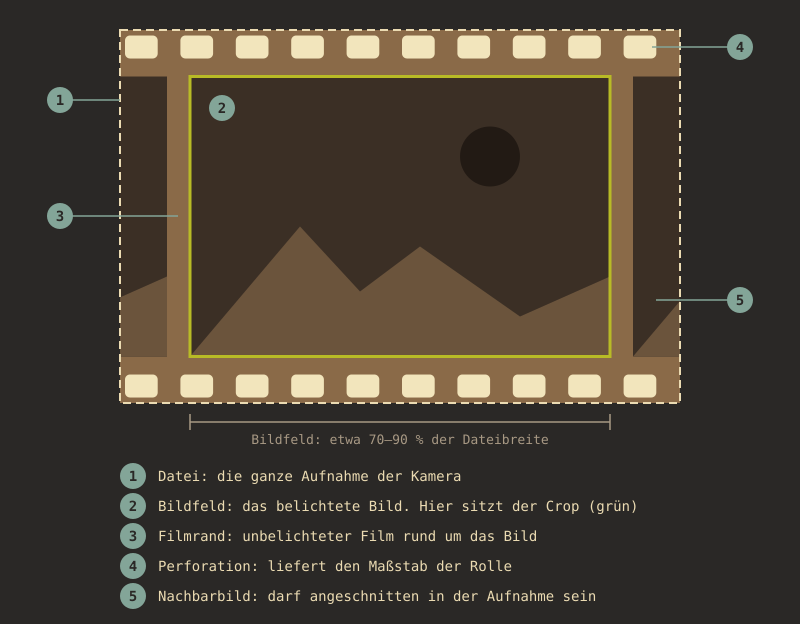

# How-to: Negative scannen für die automatische Erkennung

Diese Anleitung fasst zusammen, was den Algorithmus (`kader.py`,
`film_scale.py`) zuverlässig macht — und was ihn ausbremst. Sie richtet sich nicht
danach, was fototechnisch "am schönsten" aussieht, sondern danach, was die Erkennung
messen kann. Hintergrund und Messungen: `bericht-erkennung-2026-09-22.md`,
`roadmap.md`.

## Begriffe: was in der Aufnahme zu sehen ist

- **Datei:** die ganze Aufnahme der Kamera.
- **Bildfeld:** das belichtete Bild auf dem Film. Das ist der „Rahmen“, den Kader
  sucht, und darauf sitzt der Crop.
- **Filmrand:** der unbelichtete Film rund um das Bildfeld, auch der Steg zwischen
  zwei Bildern. Die Grenze zwischen Filmrand und Bildfeld ist die Kante, die die
  Erkennung misst (`frame_edges.py`).
- **Perforation:** die Lochreihen. Aus ihrem Abstand kommt der Maßstab der Rolle.
- **Nachbarbild:** darf angeschnitten in der Aufnahme sein.

Der Filmhalter muss nicht im Bild sein. Gebraucht werden nur der Filmrand an allen
vier Seiten des Bildfelds und mindestens eine Lochreihe.

## Die eine Regel, die am meisten bringt: Perforation mitscannen

Der wichtigste Trick des Algorithmus ist, dass der Lochabstand von 35-mm-Film
(4,7625 mm) eine physikalische Konstante ist. Daraus errechnet `film_scale.py` den
Abbildungsmaßstab der Rolle (px/mm) — unabhängig davon, wie unterschiedlich die
Motive selbst aussehen. Das funktioniert aber nur, **wenn die Perforation überhaupt
mit im Scan ist.**

- Lass beim Scannen an mindestens einer Seite (oben oder unten in der
  Transportrichtung des Films) einen sichtbaren Rand mit den Löchern stehen. Ein
  bis zwei Millimeter Luft genügen, mehr schadet nicht.
- Scanne **nicht** randscharf bis an den Bildinhalt heran, auch wenn es aufgeräumter
  aussieht. Ohne Perforation fehlt der Maßstab, und die Rahmengröße muss allein aus
  den Kanten kommen.
- Der Algorithmus sucht die Perforation in den äußeren 24 % der kurzen Bildkante
  (`EDGE_FRAC` in `film_scale.py`). Sie muss also nicht mittig im Bild liegen —
  aber sie muss in diesem Randstreifen zu finden sein, nicht komplett weggeschnitten.

## Bildfeld weder zu eng noch zu weit fassen

Das Bildfeld soll etwa 70–90 % der Dateibreite füllen. Dann liegen alle vier Kanten
des Bildfelds und beide Lochreihen sicher in der Datei, und es bleibt Platz, wenn
der Film schief liegt.

- **Zu eng** (Bildfeld über etwa 90 % der Breite): Schon ein leicht verschobener
  Film schneidet eine Kante ab, und die Lochreihen fallen aus der Datei. Eine Kante,
  die nicht in der Datei liegt, kann die Erkennung nicht finden; das Bild wird dann
  nicht grün.
- **Zu weit** (Bildfeld unter etwa 55 % der Breite): Der Lochabstand liegt außerhalb
  des Bereichs, in dem er gesucht wird (`PITCH_REL` in `film_scale.py`), und es geht
  unnötig Auflösung verloren.

## Filmhalter sauber halten

Ein Filmhalter mit eigenem periodischem Muster am Rand (Riffelung, Zahnung,
Markierungen) kann vom Algorithmus mit der Perforation verwechselt werden, wenn
dieses Muster stärker hervortritt als die eigentlichen Löcher. In den Tests führte
ein solches Fremdmuster am äußersten Bildrand zu einem falschen, zu großen
Maßstab für die ganze Rolle. Der Algorithmus bündelt heute Treffer über mehrere
Streifenlagen, um einzelne Ausreißer zu entschärfen — trotzdem gilt:

- Filmhalter und Auflagefläche vor dem Scannen von Staub, Kratzern und
  Fremdmustern freihalten.
- Wenn der Halter selbst ein regelmäßiges Muster hat (z. B. Zahnung zum Einrasten),
  darauf achten, dass es nicht in den gescannten Bereich hineinragt.

## Eine Rolle konsistent scannen

Der Algorithmus bildet aus **allen Bildern einer Rolle zusammen** ein Maß für den
Perforationstakt (Autokorrelation wird über die ganze Rolle aufsummiert, weil der
Film in jedem Scan an derselben Stelle liegt und sich der Takt dadurch verstärkt,
Bildinhalt aber nicht). Das bringt zwei praktische Anforderungen:

- **Gleiche Auflösung/Scanner-Einstellung für die ganze Rolle.** Bilder mit
  abweichender Pixelgröße werden vom Algorithmus intern verworfen (sie passen
  nicht zu den übrigen ins gemeinsame Raster). Am einfachsten: Scanner-Preset für
  eine Rolle nicht mittendrin wechseln.
- **Gleicher Bildausschnitt/Rahmen für die ganze Rolle.** Je gleichmäßiger der Film
  im Scanner liegt, desto sauberer bündeln sich die Perforationstreffer über die
  Bilder der Rolle. Wechselnde Rähmchen oder stark unterschiedliche Ausrichtung
  vom Bild zu Bild schwächen das Signal.
- **Mindestens ein paar Bilder pro Rolle scannen**, nicht nur Einzelbilder. Ab drei
  Bildern reicht dem Algorithmus schon ein niedrigerer Score, um den Takt zu
  akzeptieren; bei zwölf Bildern kann er zusätzlich prüfen, ob zwei zufällige
  Hälften der Rolle sich gegenseitig bestätigen (`agree`) — das ist inzwischen das
  wichtigste Gütemaß und braucht mehrere Bilder, um überhaupt zu funktionieren. Bei
  Einzelscans (nur ein Bild "lose" digitalisiert) fehlt diese Bestätigung, und die
  Erkennung ist entsprechend vorsichtiger (siehe unten).

## Was für "Einzelphotos" ohne Rollenkontext gilt

Nicht jedes Bild stammt von einer vollständigen Rolle mit mehreren Aufnahmen —
manchmal gibt es nur ein einzelnes Negativ. Dann kann der Algorithmus die
Hälften-Bestätigung nicht durchführen und verlässt sich stärker auf einen hohen
Autokorrelations-Score im einzelnen Bild. Für diesen Fall gilt besonders:

- Perforation an **beiden** Rändern (oben und unten) mitscannen, falls möglich —
  mehr Streifenlagen mit sichtbarem Takt erhöhen die Chance auf einen sauberen
  Treffer schon in einem einzelnen Bild.
- Scharf und kontrastreich genug scannen, dass die Löcher als klare helle/dunkle
  Kanten erscheinen, nicht verwaschen.

## Belichtung/Entwicklung: hilft, ist aber nicht entscheidend

Ob der Scan bereits entwickelt/invertiert vorliegt oder als rohes, nicht
invertiertes Bild (nur Weißabgleich) — der Perforationstakt lässt sich in beiden
Fällen messen, weil er unabhängig vom Bildinhalt ist. Entwickelte Bilder liefern
im Schnitt eine etwas zuverlässigere Konfidenzeinschätzung; unentwickelte Rohbilder
retten aber gerade die Rollen, bei denen die entwickelte Version aus anderen
Gründen scheitert. Für die Perforationsmessung selbst ist die Belichtung also
zweitrangig — wichtiger bleibt, dass die Löcher überhaupt im Bild sind und scharf
genug abgebildet werden.

## Kurz zusammengefasst

1. Perforation mitscannen — an mindestens einer Kante, lieber an beiden.
2. Bildfeld auf etwa 70–90 % der Dateibreite, alle vier Kanten in der Datei.
3. Filmhalter sauber und ohne eigenes periodisches Muster im Scanbereich.
4. Eine Rolle mit gleicher Scanner-Einstellung und ähnlichem Bildausschnitt
   durchgängig scannen, nicht mittendrin wechseln.
5. Möglichst mehrere Bilder pro Rolle statt einzelner loser Scans — ab etwa
   zwölf Bildern kann der Algorithmus seine eigene Messung gegenprüfen.
6. Bei Einzelscans ohne Rollenkontext: beide Ränder erfassen, scharf und
   kontrastreich scannen.

Wer diese Punkte beachtet, gibt der Erkennung, was sie messen kann: vier sichtbare
Kanten je Bild und einen bestätigten Maßstab je Rolle. Messwerte stehen in
`bericht-erkennung-2026-11-10.md`.
